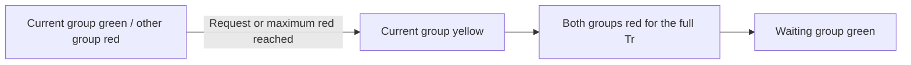

# Queue and wait data for traffic-light reinforcement learning

Use **Training data** in `build/traffic_training_ui.exe` to collect from a map you design. For many episodes without rendering, use `build/traffic_training.exe`. For agent-controlled rollouts, use `scripts/traffic_rl_env.py`.

This adds data collection and a live environment, not a trainer or trained policy weights.

## Record from the app

1. Load/design a map, mark spawn nodes and destinations, and assign every lane's exits. Add two to four physical lights and assign them to the two synchronized control groups.
2. Open **Training data**. Set the camera's maximum upstream range and the short/moderate queue cutoffs in metres. Set each light's group; camera width follows the stop line unless a custom region width was configured in RL controller.
3. Set the maximum red hold, yellow time, final all-red **Tr**, minimum green and decision interval.
4. Configure independent random spawn rates: seed, minimum/maximum vehicles per second, rate-change intervals, and quiet-period probability.
5. Select your dataset folder. Leave **Append to existing dataset** enabled to add runs, or disable it to require a new empty folder. Click **Start recording and run**. This resets vehicles to the selected seed. Each run gets a unique subfolder containing its original CSVs, transitions and scenario snapshots.
6. **Stop and finish dataset** finalizes the terminal transition, marks uncrossed waits as censored, and restores manual light timings and the original node spawn rates. A map/network/engine reset or closing the app also finishes the current run.

Random hold/switch exploration generates actions without requiring trained weights. Disable it to use the three manual request buttons during recording. A change made by a manual request closes the preceding partial transition before recording the new action.

## Append runs to one dataset

Select the same dataset folder each time and enable **Append to existing dataset**. **Stop and finish dataset** finalizes the episode and adds its records to `<dataset>/transitions.jsonl`. Closing/resetting the app also finalizes an active run. The combined file is published only after the run finishes; the run's own files are written during recording.

Each new combined record has a `session_id` matching its run subfolder. Simulation times, vehicle IDs and wait-episode IDs remain local to that run. Terminal `done` records preserve episode boundaries. Seeds and the original 28-feature schema are retained. Read the **root combined file once** when training; also recursively reading the run files would duplicate those records. Look up each run's `metadata.json`, CSVs and map/network snapshots in its `session_id` folder.

An existing single-run folder can also be selected: its transition bytes and metadata are preserved, and new run folders are added beneath it. Original legacy combined rows may lack `session_id`; newly appended rows have it. If an older dataset has only episode subfolders, their finished transitions are included when its combined file is first created. Do not manually delete the combined file to add runs; choose that same folder and append.

Only one recorder can publish to a dataset at once. Incompatible, incomplete or unfinished transition files are rejected without changing existing records. Publishing writes a replacement file beside the dataset and replaces the combined file atomically, so it temporarily needs space for a second copy. If publication fails, the per-run recording remains available and the app offers **Retry saving dataset**.

## Hold, forced switch, and Tr

The hold controller does not run a repeating green-duration cycle. The model can continue holding the current allocation. Requesting the other group starts a switch once minimum green is satisfied. The red-age threshold forces a switch even if actions keep requesting hold/current green.



**Tr is the final all-red clearance at the end of the waiting group's red phase.** It starts after the previous green group's yellow finishes. No request can cancel or restart an in-progress yellow/Tr transition. After Tr completes, the waiting group receives green. Both physical lights belonging to a group always receive the same held phase.

The maximum-red setting is the threshold to *begin* the forced switch, not a promise to release the red at that exact instant. Red can therefore last up to that threshold plus yellow plus Tr, rounded up by the physics step. The controller requires `maximum red >= Tr + minimum green` so mandatory clearance and minimum service fit together. Boundaries are processed in simulation time; a step spanning a boundary can lengthen clearance but cannot shorten Tr. Pausing does not advance timers.

Defaults: maximum red 60 s, yellow 3 s, Tr 8 s, minimum green 5 s, decision interval 5 s. All are configurable. Existing IN/OUT directions and permissive exit rules are preserved. Existing permissive red-turn vehicles may still use their allowed exits; normal vehicle conflict checks continue to apply.

The older density-v1 green-duration controller remains available for existing weights. The queue/wait environment uses the new hold/request contract.

## Camera-limited queues

Only OUT-direction traffic in the upstream camera corridor is considered. The maximum range is configurable (default 80 m); bodies entirely outside it are not observed. A partially visible body at the camera edge is included and queue extent is capped at the camera range.

The queue is the tracked waiting cohort, including vehicles rolling forward after an earlier stop until they clear the line. Length is the distance from the stop line to the furthest visible rear of that cohort. The camera-limit flag means a tracked rear touches the observation limit; it is not a claim that the entire real queue is visible. A queue beyond the camera limit cannot be distinguished from another longer queue through these observations.

| Category | Default rule |
| --- | --- |
| none / 0 | No tracked waiting vehicles |
| short / 1 | Visible queue length up to 20 m |
| moderate / 2 | More than 20 m, up to 60 m |
| long / 3 | More than 60 m, up to the camera range |

The short/moderate cutoffs are editable. Queue length for a group is the **maximum** of its individual approaches, not the sum of opposing road lengths. Group vehicle counts sum those approaches. Density is measured over the same camera-range rectangles, using occupied OUT-direction vehicle footprint area / rectangle area.

## Wait tracking

A stopped vehicle is attributed to the nearest enabled OUT-controlling light ahead within its visible camera corridor when that light is red/yellow, or when an already-tracked residual queue is clearing there. This camera/approach rule includes followers well behind the first stopped vehicle; it does not require their bodies to touch the line. It is an approach-based attribution, so it can also include a visible vehicle delayed by another obstruction on that red approach. It does not attempt counterfactual inference about collision/driver causes.

Each vehicle has one active **signal-wait episode** at a time:

- At sampled speed at or below 0.05 m/s, stopped time accumulates for that signal.
- When the vehicle rolls, accumulation pauses; its previous wait remains.
- If it stops again before clearing the same signal, the new stopped interval is added to that previous wait. `stop_bursts` counts these separate stopped intervals.
- The episode finishes only once the vehicle's **rear** clears the stop line. Speed resuming alone never clears it.
- A disappearing vehicle, a removed signal, leaving the camera corridor, resetting, or ending a run produces a separately labeled censored record rather than a successful crossing.

Maximum/minimum/median/mean in observations describe the cumulative waits of the **currently tracked cohort**, including rolling vehicles that have not cleared the line. Their sample count is also exported. An empty cohort has count 0 and numeric summaries 0. Completed/censored waits are retained individually in `wait_episodes.csv`, so lifetime/completed-only summaries can be computed without mixing them into the current queue state.

Tracking is sampled at the simulation step, so a stop/crossing boundary has that step's time resolution. Headless physics steps are at most 0.1 s. Waiting before a vehicle first enters camera range is not invented retrospectively. The existing whole-trip stopped-time counters remain separate; these new statistics are specifically per signal visit.

## Random demand

Every marked spawn node has its own changing rate and next change time. Nonzero rates are sampled **log-uniformly** within the configured minimum/maximum; quiet periods set that node's rate to zero. Arrivals are **Poisson**, rather than evenly spaced. Rate-change events and arrivals are processed chronologically, including arrivals immediately before a rate change.

The seed controls demand, vehicle sampling and exploration in a repeatable run. Batch episodes use `seed + episode_index`; each episode's exploration stream is seeded independently. Same-seed replay is tested for the same Native execution mode/settings. Different engines/physics-step configurations are separate experiments.

`spawn_rates.csv` records requested rates, and `spawn_attempts.csv` records whether each arrival request was inserted. A full vehicle limit or an infeasible trip can reject insertion; such requests are recorded rather than silently counted as vehicles. Node rates are restored after app recording stops.

## Exported files

| File | Contents |
| --- | --- |
| `groups.csv` | One row per group per approximately one simulated second: queues, phase/red ages, Tr countdown, wait summaries and density |
| `lights.csv` | The same measurements per physical signal ID |
| `wait_episodes.csv` | Vehicle/signal IDs, first stop/end time, cumulative stopped time, stop bursts, outcome |
| `spawn_rates.csv` | Every node's rate-change time and rate |
| `spawn_attempts.csv` | Requested arrival processing time, node, current rate, insertion success |
| `transitions.jsonl` | State, requested/arbitrated action, per-agent actions, reward, next state, done and forced-switch flag |
| `metadata.json` | Dataset schema, seed, cutoffs/range, timing, demand settings and feature/action names |
| `environment.json` | Engine, scale, decision interval and limits |
| `map.png`, `network.nodes`, `.signals` companions | Snapshot of the map/network and original manual light configuration |
| `camera_groups.csv` | Stable signal IDs, group assignment and camera configuration; width 0 means use the stop-line width |
| `vehicle_profiles.csv` | App recorder's current vehicle profiles and spawn percentages; the headless runner uses the built-in Vietnamese profiles |

Machine-readable groups are 0 and 1; the app labels these group 1 and group 2. Signal IDs are stable identities, not the zero-based `L` selection index.

Random exploration data are rollouts, not expert actions. The default reward is **negative additional signal-wait seconds during that step**, with one reward per group and a global summed reward. Camera-invisible waits do not enter that reward. Arrival counts and spawn request/insertion counts are exposed by the live environment for experiments that need a different objective. No claim is made that this particular reward is sufficient for every traffic-control task.

## Generate many episodes without the UI

```powershell
.\build\traffic_training.exe `
  --map "path\map.png" `
  --nodes "path\network.nodes" `
  --signals "path\map.png.signals" `
  --output "build\training-data\experiment-01" `
  --episodes 100 --duration 600 --seed 42 `
  --camera-range 80 --short-limit 20 --moderate-limit 60 `
  --max-red 60 --tr 8 --yellow 3 --min-green 5 `
  --min-rate 0.02 --max-rate 1.5 `
  --rate-change-min 10 --rate-change-max 40 --zero-probability 0.15 `
  --decision-interval 5 --max-vehicles 500 --meters-per-pixel 1
```

Save the PNG/network/signals before starting this process. Native execution is headless and does not alter those inputs. Reusing `--output` appends to its combined `transitions.jsonl` by default, even across process restarts. Every episode gets a unique folder, including repeated seeds. Use `--append false` to require an empty output folder at the start of a batch; later episodes in that batch still join the same dataset. The Python adapter accepts `append=False` for the same behavior. For custom group membership, supply `--groups 0,1,1` with one value per signal sorted by stable ID. Otherwise horizontal OUT approaches default to group 0, vertical to group 1. For maps at another physical scale, set `--meters-per-pixel` to their actual scale.

## Train through the live Python environment

Use the live interface for rollouts where your learning algorithm supplies the actions. This avoids trying to treat an arbitrary saved random dataset as fresh agent-generated experience.

```python
import sys
sys.path.insert(0, "scripts")
from traffic_rl_env import TrafficLightEnv

with TrafficLightEnv(
    "path/map.png", "path/network.nodes", "path/map.png.signals",
    output="build/training-data/agent-run",
    duration=600, decision_interval=5, camera_range=80,
    max_red=60, tr=8, yellow=3, min_green=5,
    min_rate=0.02, max_rate=1.5,
) as env:
    observations, info = env.reset(seed=42)  # float32 [2,14]
    done = False
    while not done:
        requests = trained_or_exploring_agents(observations)  # [0/1, 0/1]
        observations, rewards, done, truncated, info = env.step(requests)
        # rewards: float32 [2]; store this transition in your trainer.
```

This adapter does not depend on Gym and does not claim a framework-specific multi-agent API. Connect its reset/step calls to the trainer you choose. Flatten `[2,14]` to 28 values when a centralized state is needed. The live process automatically records its transitions too.

Per-agent actions are **0 = hold**, **1 = request my group's green**. If both request simultaneously, the non-green group wins; during a transition with no green, group 0 is the deterministic tie-break. The controller still enforces minimum green, maximum red and non-cancellable yellow/Tr. The original two-agent requests and the selected global action are both exported. Alternatively pass a single global action: **0 = request group 0**, **1 = request group 1**, **2 = hold**.

Every step advances the requested decision interval, shortened at episode end. `info` includes time, forced-switch status, completed arrivals, active vehicles, requested/inserted spawn counts, and dataset directory. Reset creates a new simulator/episode; ending or resetting censors visits that did not cross.

## Traffic-v2 policy observation/export contract

There are 14 raw features per agent, ordered as follows:

| Index | Feature |
| --- | --- |
| 0 | Queue category 0/1/2/3 |
| 1 | Visible queue length, metres |
| 2 | Tracked queued vehicle count |
| 3 | Camera-limit flag 0/1 |
| 4 | Actual phase: red 0, yellow 1, green 2; mixed/unavailable -1 |
| 5 | Seconds since that actual phase changed |
| 6 | Current red age in seconds; 0 when not red |
| 7 | Final Tr remaining seconds; -1 when not in that group's release clearance |
| 8 | Wait-summary sample count |
| 9 | Minimum cumulative signal wait, seconds |
| 10 | Maximum cumulative signal wait, seconds |
| 11 | Median cumulative signal wait, seconds |
| 12 | Mean cumulative signal wait, seconds |
| 13 | OUT footprint-area density 0–1 |

No normalization of these raw metres/seconds/counts is guessed. Train/export the same preprocessing with your network. Queue-category thresholds, camera geometry, timing and agent order must match training.

The existing ONNX/TorchScript loader now accepts an explicitly tagged v2 export. For `actor.onnx`, use `actor.onnx.json`:

```json
{
  "schema": 1,
  "algorithm": "MAPPO",
  "observation_schema": "traffic_v2",
  "layout": "per_group",
  "observation_input": "observations",
  "action_mode": "hold_scores"
}
```

`per_group` input is float32 `[2,14]`; `joint` input is `[1,28]`. `hold_scores` output is `[2,2]` or `[1,2,2]`, with hold/request logits or Q values per group. `hold_requests` alternatively returns two exact 0/1 actions, shape `[2]`, `[1,2]` or `[2,1]`. Optional mask remains `[2,1]`/`[1,2]`, and optional graph adjacency remains `[2,2]`. All nine model-family identifiers and the unknown-model selection dialog remain supported.

**DQN** is also supported, separately from IDQN. A centralized DQN can export one three-action Q head with `layout: "joint"` and `action_mode: "joint_hold_scores"`. Its input is `[1,28]`; output is `[3]` or `[1,3]`, ordered **request group 0, request group 1, hold**. Inference takes the argmax and passes the chosen request through the same minimum-green, maximum-red, yellow and Tr constraints. Set `algorithm: "DQN"` in the sidecar or `traffic.algorithm = DQN` in ONNX metadata; an unambiguous `dqn` filename token is also auto-detected. Per-group DQN exports can continue using `hold_scores` or legacy `discrete_scores` as appropriate. Export the trained Q network; raw state dictionaries still require their training architecture.

The sidecar's `schema: 1` identifies the policy-metadata format; `observation_schema: traffic_v2` identifies these new 28 inputs. Dataset rows separately use `schema: 2`. Legacy density-v1 exports continue to use the old two-density/green-duration contract, so they are not silently fed incompatible features.

## Checks

```powershell
cmake --build build --target traffic_ui traffic_training training_data_tests sumo_ui_smoke policy_runtime_tests -j 4
ctest --test-dir build -R "training_data|training_environment|training_ui|policy_worker" --output-on-failure
```

Checks cover repeated-stop accumulation, rear-clearance completion, median/mean values, camera clipping, forced hold switching, the full Tr interval, seeded rate/arrival replay, non-overwriting exports, live Python reset/step, original joint actions, v2 model inference and UI recording/restoration. Trial episodes on the supplied junction are in `build/training-validation-v2`.
